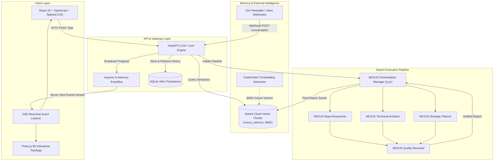
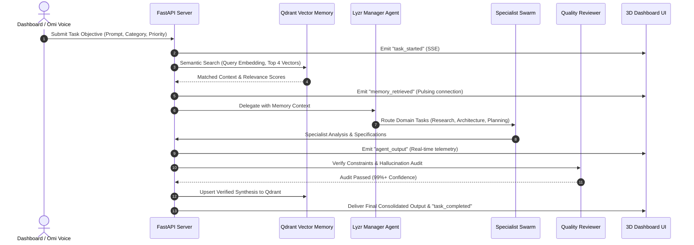

# NEXUS AI — System Architecture & Multi-Agent Swarm Topology

NEXUS AI is a production-grade, collaborative multi-agent orchestration dashboard. A central **Lyzr Manager Agent** decomposes user objectives, extracts context from **Qdrant Shared Vector Memory**, delegates specialized micro-tasks across autonomous specialist nodes, and enforces quality verification before delivering consolidated reports.

---

## 1. High-Level Architecture Diagram

---

## 2. Core Execution Lifecycle

---

## 3. Data Storage Topologies

1. **Relational State (SQLite WAL Mode `nexus_data.db`)**:
   - `tasks`: Full metadata, execution mode, prompts, durations, assigned agents, final outputs.
   - `task_events`: Event sourcing audit log (agent names, timestamps, statuses, JSON payloads).
   - `agents`: Registered Lyzr Agent IDs, availability, total invocations, average latencies.
   - `voice_conversations`: Ingested Omi transcripts, speakers, extracted action items.

2. **Vector Space (Qdrant Cloud `nexus_memory`)**:
   - Vector dimension: `384`
   - Distance metric: `Cosine`
   - Payload schema: `memory_id`, `text`, `user_id`, `task_id`, `topic`, `source`, `created_at`, `metadata`.
